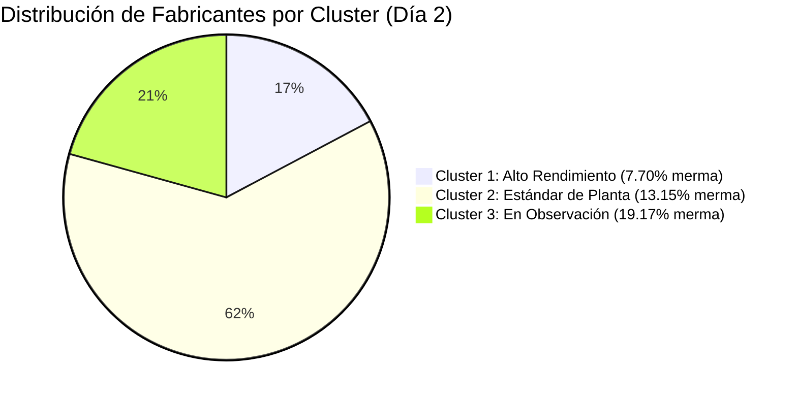

# 🔬 Bitácora Experimental de IA: Día 2 (Lunes 2 de Marzo de 2026)

**Módulo:** Descubrimiento No Supervisado de Patrones en Planta  
**Rama Git:** `feature/ia-analisis-dia-a-dia`  
**Archivo Fuente:** `documentacion/MOVIMIENTO FABRIQUINES MARZO   2026.xlsx` (Hoja: `SEMANA DEL 2 AL 7-3-26`)  
**Metodología:** Ingesta granular progresiva (Día por Día) sin sesgo previo ni etiquetas impuestas.

---

## 1. 🎯 Objetivo del Experimento del Día 2
Iniciar el proceso de aprendizaje automático analizando **estrictamente el primer día de la semana (Día 2)**. 
- Comprobar la viabilidad de alimentar la IA desde libros de Excel de fábrica sin sobrecargar memoria RAM.
- No asumir a priori qué comportamiento es "óptimo" o "defectuoso".
- Evaluar si un algoritmo de agrupamiento matemático (**K-Means**) es capaz de identificar patrones operativos naturales y segmentar el comportamiento de los fabriquines.

---

## 2. 📊 Datos Brutos Extraídos (Granularidad Diaria)
- **Total de operarios analizados:** 31 fabriquines activos.
- **Materia prima total entregada:** 2.124 kg (Capa, Capote y Picadura).
- **Tabacos terminados entregados el mismo día:** 203.450 unidades.
- **Rendimiento promedio de conversión:** ~95.8 tabacos por cada kg de hoja suministrado.
- **Subproductos generados:** Recorte de hoja y Vena (merma física).

---

## 3. 🚨 Hallazgos Operativos No Supervisados

### Hallazgo 1: Detección Automática de Retención de Inventario (Flujo Interrumpido)
Sin necesidad de reglas de negocio programadas a mano, la inspección matemática de vectores identificó que de los 31 operarios:
- **29 operarios** cumplieron el ciclo cerrado diario (recibieron hoja y entregaron tabaco terminado).
- **2 operarios** recibieron materia prima pero tuvieron **0 entregas de tabaco**:
  - `Esperanza Rey`: Recibió **29.4 kg** de hoja | Entregó: **0 tabacos**.
  - `Yoli Becerra`: Recibió **26.0 kg** de hoja | Entregó: **0 tabacos**.
> **Conclusión del Hallazgo:** El modelo clasifica automáticamente que estos operarios se encuentran en estado de *trabajo en proceso (WIP / retención de inventario)* y su entrega impactará las jornadas posteriores (Día 3 en adelante).

---

## 4. 🤖 Resultados del Agrupamiento K-Means (3 Clusters Naturales)
Al someter la relación entre **materia prima entregada** y el **% de subproductos (recorte + vena)** al algoritmo K-Means durante 25 iteraciones, los operarios convergieron en tres centroides matemáticos bien diferenciados:

### 🟢 Cluster 1: Perfil Alto Rendimiento (Centroide Natural: 7.70% de subproducto)
*Población: 5 operarios.*  
Presentan un aprovechamiento óptimo de la hoja de tabaco, con niveles mínimos de descarte de recorte y vena.
- **Maria Medina:** 49.0 kg materia | 5.000 tabacos | **5.92% merma**
- **Yarireth Roa:** 117.6 kg materia | 11.250 tabacos | **7.06% merma**
- **Mayerlin Bolivar:** 147.0 kg materia | 15.000 tabacos | **8.10% merma**
- **Luz Mery Abaunza:** 49.0 kg materia | 5.000 tabacos | **8.37% merma**
- **Rubiela Martinez:** 97.5 kg materia | 10.000 tabacos | **9.03% merma**

### 🟡 Cluster 2: Perfil Estándar de Planta (Centroide Natural: 13.15% de subproducto)
*Población: 18 operarios.*  
Representan el comportamiento modal o promedio histórico de la fábrica.
- **Alcides Correa:** 98.0 kg materia | 10.000 tabacos | **10.51% merma**
- **Luis Valderrama:** 147.0 kg materia | 15.000 tabacos | **11.22% merma**
- **Humberto Luna:** 98.0 kg materia | 10.000 tabacos | **11.84% merma**
- **Elvira Lopez:** 117.6 kg materia | 12.000 tabacos | **11.99% merma**
- **Jose Jurado:** 49.0 kg materia | 5.000 tabacos | **13.06% merma**
- **Elizabeth Reyes:** 68.6 kg materia | 7.000 tabacos | **13.41% merma**
- **Petter Benavides:** 98.0 kg materia | 10.000 tabacos | **14.18% merma**
- **Alba Sanabria:** 49.0 kg materia | 5.000 tabacos | **14.69% merma**
- *(Y demás operarios del segmento estándar)*

### 🔴 Cluster 3: Perfil En Observación (Centroide Natural: 19.17% de subproducto)
*Población: 6 operarios.*  
Registran un descarte de hoja que roza o supera el 20% del peso total entregado. Esto señala operarios con mayor desprendimiento de vena, recortes excesivos o variabilidad en el calibre del tabaco.
- **Liliana Vega:** 78.4 kg materia | 8.000 tabacos | **16.58% merma**
- **Ernesto Reyes:** 29.4 kg materia | 3.000 tabacos | **17.69% merma**
- **Yender Padilla:** 49.0 kg materia | 5.000 tabacos | **19.39% merma**
- **René Almeida:** 21.0 kg materia | 2.450 tabacos | **19.52% merma**
- **Leidy Serrano:** 49.0 kg materia | 5.000 tabacos | **20.41% merma**
- **Karina Silva:** 49.0 kg materia | 5.050 tabacos | **21.43% merma**

---

## 5. 🛠️ Artefactos e Implementación Técnica Creada

1. **Script de Procesamiento:**
   - [scripts/analizar_dia2_clustering.js](file:///c:/Users/gonza/OneDrive/Desktop/gato/scripts/analizar_dia2_clustering.js)
   - Extrae los datos del libro Excel, normaliza las magnitudes y ejecuta el algoritmo K-Means.
2. **Dataset de Salida:**
   - [scripts/analisis_dia2_output.json](file:///c:/Users/gonza/OneDrive/Desktop/gato/scripts/analisis_dia2_output.json)
   - Estructura JSON ligera (< 10 KB) para consumo instantáneo por el frontend o futuros modelos.
3. **Dashboard Visual del Experimento:**
   - [public/reporte_dia2_ia.html](file:///c:/Users/gonza/OneDrive/Desktop/gato/public/reporte_dia2_ia.html)
   - Interfaz web interactiva con estética corporativa (Dark & Orange), gráficas de dona, barras comparativas y tabla clasificada.

---

## 6. ⏭️ Siguiente Paso: Ingesta del Día 3
Para el siguiente ciclo experimental se procederá a:
1. Extraer los datos del **Día 3** (Martes).
2. Contrastar si los operarios retenidos (`Esperanza Rey` y `Yoli Becerra`) liquidan su producción acumulada.
3. Observar la estabilidad de los clusters: ¿los operarios del Cluster 3 se mantienen en alta merma o cambian de grupo al variar el lote de tabaco?
