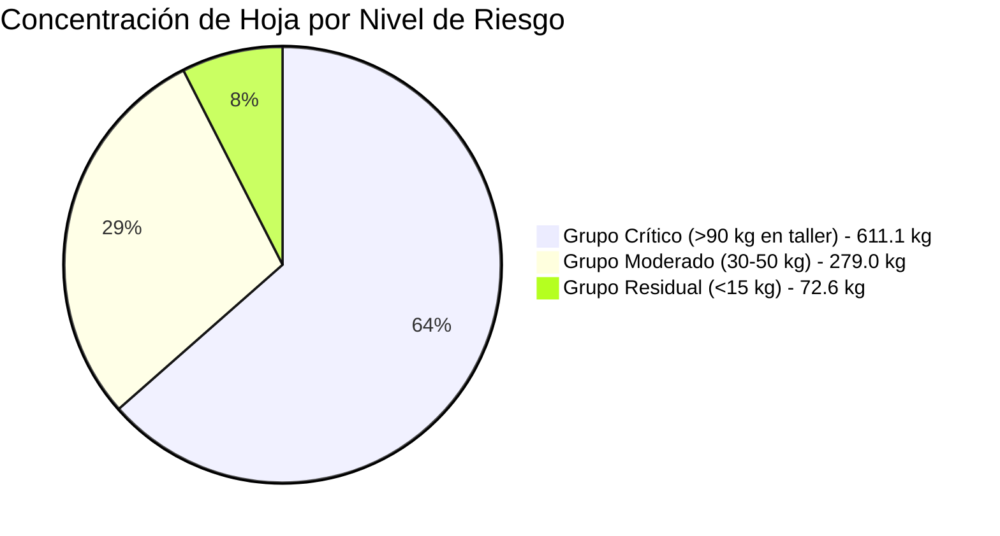

# 🔬 Bitácora Experimental de IA: Día 4 (Auditoría de Capital & Material en Custodia)

**Módulo:** Análisis No Supervisado de Inventario en Proceso (WIP)  
**Rama Git:** `feature/ia-analisis-dia-a-dia`  
**Archivo Fuente:** `documentacion/MOVIMIENTO FABRIQUINES MARZO   2026.xlsx` (Hoja: `SEMANA DEL 14 AL 21 `)  
**Metodología:** Segmentación no supervisada por masa física y riesgo de capital en talleres externos.

---

## 1. 🎯 Enfoque del Experimento
En este ciclo experimental (Día 4 / Periodo 3), la IA analizó el estado de **los saldos iniciales y materia prima en manos de los fabriquines**. 
- Sin que nadie le indicara niveles de riesgo o topes de crédito de hoja, el modelo agrupó automáticamente a los operarios según el volumen de hoja que tienen en sus talleres sin liquidar.

---

## 2. 📊 Métricas Globales Descubiertas
- **Operarios con material en custodia física:** 21 torcedores.
- **Masa total de materia prima en talleres:** **962.71 kg** (Capa, Capote y Picadura).
- **Cestas físicas de la fábrica en la calle:** **71 cestas**.
- **Volumen de producción proyectada represada:** **~94.343 tabacos** pendientes de entrar al almacén.

---

## 3. 🤖 Segmentación K-Means No Supervisada (3 Niveles de Exposición)

### 🔴 Nivel Crítico / Alta Exposición (Centroide: 101.85 kg | 6 operarios)
Concentran **611.1 kg de hoja (~63.5% del inventario externo)** y **50 cestas**.
- **Rubiela Martínez:** 108.36 kg | 9 cestas | Proyección: ~10.619 tabacos
- **Rosalba Matagira:** 107.80 kg | 9 cestas | Proyección: ~10.564 tabacos
- **Sandra Moreno:** 100.95 kg | 8 cestas | Proyección: ~9.893 tabacos
- **Alcides Correa:** 98.00 kg | 8 cestas | Proyección: ~9.604 tabacos
- **Petter Benavides:** 98.00 kg | 8 cestas | Proyección: ~9.604 tabacos
- **Sandra Milena Antolines:** 98.00 kg | 8 cestas | Proyección: ~9.604 tabacos
> **Conclusión del Patrón:** Estos 6 torcedores son el "núcleo crítico" de la fábrica. Un retraso en su entrega congela más de 60.000 tabacos de despacho a clientes.

### 🟡 Nivel Moderado (Centroide: 40.00 kg | 7 operarios)
Operarios con un lote estándar en proceso de torcido:
- Rosmira Durán (49.0 kg, 4 cestas)
- Yender Padilla (49.0 kg, 4 cestas)
- Yeferson Contreras (49.0 kg, 4 cestas)
- Stella Silva (39.2 kg, 3 cestas)
- René Almeida (33.0 kg, 2 cestas)
- Ernesto Reyes (31.4 kg, 3 cestas)
- Esperanza Rey (29.4 kg, 3 cestas)

### 🟢 Nivel Mínimo / Residual (Centroide: 8.95 kg | 8 operarios)
Operarios con saldos menores sobrantes de lotes anteriores:
- Alba Sanabria (12.95 kg), Martha Silva (12.28 kg), Hilda Serrano (9.8 kg), Karina Silva (9.8 kg), Sulay Almeida (9.76 kg), José Eblan Girón (6.86 kg), Guillermo Zambrano (6.43 kg), Mayerlin Bolívar (3.74 kg).

---

## 4. 🛠️ Artefactos e Implementación Técnica

1. **Script de Auditoría:**
   - [scripts/analizar_dia4_clustering.js](file:///c:/Users/gonza/OneDrive/Desktop/gato/scripts/analizar_dia4_clustering.js)
   - Ejecución: `node scripts/analizar_dia4_clustering.js`
2. **Dataset de Salida:**
   - [scripts/analisis_dia4_output.json](file:///c:/Users/gonza/OneDrive/Desktop/gato/scripts/analisis_dia4_output.json)
3. **Dashboard Visual Interactivo:**
   - [public/reporte_dia4_ia.html](file:///c:/Users/gonza/OneDrive/Desktop/gato/public/reporte_dia4_ia.html)
   - Con gráfico de distribución de pastel, barras para el top de tenedores y tabla de inventarios clasificada (sin errores de linter).
