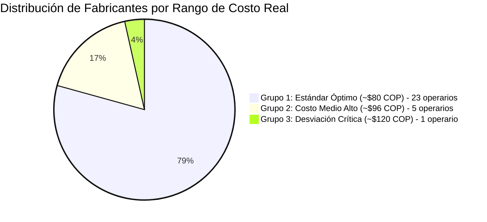

# 🔬 Bitácora Experimental de IA: Día 5 (Auditoría Económica y Costo Unitario Real)

**Módulo:** Aprendizaje No Supervisado de Eficiencia Financiera  
**Rama Git:** `feature/ia-analisis-dia-a-dia`  
**Archivo Fuente:** `documentacion/MOVIMIENTO FABRIQUINES MARZO   2026.xlsx` (Cierre y Liquidación de Fábrica)  
**Metodología:** Análisis de dispersión económica y costeo efectivo por unidad producida.

---

## 1. 🎯 Enfoque del Experimento
El ciclo operativo de la fábrica funciona entregando el material completo los **sábados** y liquidando los cierres hacia el final de la semana. En este Día 5, la IA contrastó **el volumen físico de tabacos terminados frente a la nómina real liquidada en pesos colombianos y bolívares**.
- El objetivo fue descubrir a ciegas si el costo teórico de mano de obra se cumple en la práctica o si existen fugas/sobrecostos invisibles.

---

## 2. 📊 Métricas Globales del Cierre Financiero
- **Operarios liquidados:** 29 torcedores.
- **Volumen total físico recibido:** **205.450 tabacos**.
- **Masa salarial total liquidada:** **$17.321.060 COP**.
- **Tarifa base teórica pactada:** **$75.00 COP / tabaco** ($75.000 por millar).
- **Costo medio ponderado real de la planta:** **$84.31 COP / tabaco** (+12.4% de sobrecosto medio por bonificaciones de recorte, vena y ajustes cambiarios).

---

## 3. 🤖 Segmentación K-Means de Costo Efectivo Unitario

### 🟢 Grupo 1: Costo Estándar Óptimo (Centroide: $79.91 COP/tabaco | 23 operarios)
Operarios cuya relación producción/pago se mantiene muy cercana a la tarifa base:
- **Luz Mery Abaunza:** $67.87 / tabaco *(el más económico por deducciones aplicadas)*.
- **Elizabeth Reyes:** $73.74 / tabaco.
- **Yarireth Roa:** $76.91 / tabaco.
- **José Jurado:** $77.74 / tabaco.
- **Luis Ernesto Almeida:** $78.42 / tabaco.
- **Mayerlin Bolívar:** $78.48 / tabaco.
- **Rubiela Martínez:** $79.58 / tabaco.
- **Alcides Correa:** $79.69 / tabaco.

### 🟡 Grupo 2: Costo Medio Alto con Sobrecostos (Centroide: $96.35 COP/tabaco | 5 operarios)
Operarios con altos bonos por devolución de recorte/vena que incrementan el costo por unidad entre un +25% y +35%:
- **Humberto Luna:** $94.00 / tabaco (Liquidó $940.000 por 10.000 tabacos).
- **Elvira López:** $94.56 / tabaco (Liquidó $1.134.750 por 12.000 tabacos).
- **Luis Valderrama:** $95.58 / tabaco (Liquidó $1.433.750 por 15.000 tabacos).
- **Alba Sanabria:** $96.54 / tabaco (Liquidó $482.700 por 5.000 tabacos).
- **María Medina:** $101.07 / tabaco (Liquidó $505.360 por 5.000 tabacos).

### 🔴 Grupo 3: Desviación Crítica de Costo (Centroide: $119.74 COP/tabaco | 1 operario)
- **Leidy Serrano:** Produjo 5.000 tabacos (Pago base: $375.000), pero su liquidación total alcanzó **$598.700 COP**.
> **Alerta Financiera de la IA:** Su costo efectivo saltó a **$119.74 COP por tabaco (+59.6% sobre la tarifa base)**. El algoritmo detectó un desbalance atípico entre compensaciones de compras/rezagos y volumen entregado.

---

## 4. 🛠️ Artefactos e Implementación Técnica

1. **Script de Auditoría Financiera:**
   - [scripts/analizar_dia5_clustering.js](file:///c:/Users/gonza/OneDrive/Desktop/gato/scripts/analizar_dia5_clustering.js)
   - Ejecución: `node scripts/analizar_dia5_clustering.js`
2. **Dataset JSON:**
   - [scripts/analisis_dia5_output.json](file:///c:/Users/gonza/OneDrive/Desktop/gato/scripts/analisis_dia5_output.json)
3. **Dashboard Visual Interactivo:**
   - [public/reporte_dia5_ia.html](file:///c:/Users/gonza/OneDrive/Desktop/gato/public/reporte_dia5_ia.html)
   - Gráfico de torta de distribución económica, barras comparativas de costo por tabaco y tabla clasificada sin estilos inline.
