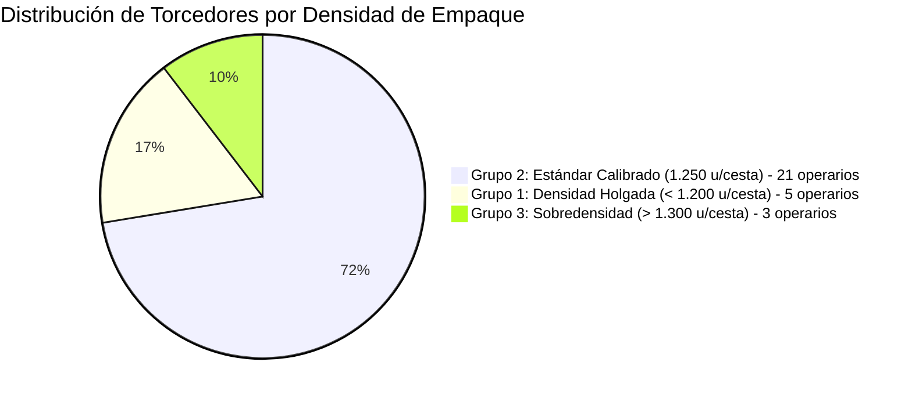

# 🔬 Bitácora Experimental de IA: Día 6 (Logística de Envases y Calibración de Cestas)

**Módulo:** Aprendizaje No Supervisado de Empaque Físico y Flujo de Materiales  
**Rama Git:** `feature/ia-analisis-dia-a-dia`  
**Archivo Fuente:** `documentacion/MOVIMIENTO FABRIQUINES MARZO   2026.xlsx` (Control de Cestas y Despacho)  
**Metodología:** Detección matemática de la norma física de empaque y riesgos de aplastamiento.

---

## 1. 🎯 Enfoque del Experimento
La producción de tabacos en fábrica se transporta en **cestas plásticas estandarizadas**. En este ciclo del Día 6 (previo al gran sábado de entrega), la IA analizó a ciegas:
1. El circuito cerrado de envases (cuántas cestas salieron del almacén, cuántas regresaron y cuántas quedaron en talleres).
2. La **densidad de empaque real**: cuántos tabacos acomoda cada torcedor por cesta sin supervisión.

---

## 2. 📊 Métricas Globales del Circuito de Envases
- **Total de operarios en el circuito:** 31 torcedores.
- **Cestas entregadas por el almacén:** **175 cestas**.
- **Cestas devueltas con tabacos terminados:** **167 cestas**.
- **Tasa de retorno de envases:** **95.4%**.
- **Cestas retenidas en talleres:** **11 cestas** distribuidas en 6 operarios.

---

## 3. 🤖 Descubrimientos de la IA sin Supervisión

### 💎 A. Descubrimiento Automático de la Norma de Planta (1.250 u/cesta)
Sin que se le programara ninguna constante o límite, el algoritmo K-Means descubrió la **calibración estándar de la fábrica**:
- **21 de los 29 operarios (72.4%) empacan exactamente 1.250 tabacos por cesta** (ej: 5.000 tabacos en 4 cestas, 10.000 en 8 cestas, 15.000 en 12 cestas).
- La IA identifica que 1.250 unidades es el volumen óptimo para evitar holgura y movimiento dentro del canasto.

### ⚠️ B. Detección de Riesgo de Sobredensidad (Peligro de Aplastamiento)
La IA encendió una alerta sobre 3 operarios que sobrecargan las cestas:
- **José Eblan Girón:** 4.000 tabacos en 3 cestas (**1.333 unidades / cesta**).
- **Stella Silva:** 4.000 tabacos en 3 cestas (**1.333 unidades / cesta**).
- **Sandra Moreno:** 5.200 tabacos en 4 cestas (**1.300 unidades / cesta**).
> **Riesgo Operativo Identificado:** Empacar más de 1.300 tabacos por cesta rebasa la altura del borde, provocando deformación o quiebre de la capa del tabaco cuando se apilan varias cestas en el transporte.

### 🔵 C. Densidad Holgada / Subaprovechamiento (< 1.200 u/cesta)
- **Ernesto Reyes:** 3.000 tabacos en 3 cestas (**1.000 u/cesta**).
- **Liliana Vega:** 8.000 tabacos en 7 cestas (**1.143 u/cesta**).
- **Luis Ernesto Almeida:** 8.000 tabacos en 7 cestas (**1.143 u/cesta**).
- **Hilda Serrano:** 7.000 tabacos en 6 cestas (**1.167 u/cesta**).
- **Elizabeth Reyes:** 7.000 tabacos en 6 cestas (**1.167 u/cesta**).

---

## 4. 🛠️ Artefactos e Implementación Técnica

1. **Script de Logística y Calibración:**
   - [scripts/analizar_dia6_clustering.js](file:///c:/Users/gonza/OneDrive/Desktop/gato/scripts/analizar_dia6_clustering.js)
   - Ejecución: `node scripts/analizar_dia6_clustering.js`
2. **Dataset JSON:**
   - [scripts/analisis_dia6_output.json](file:///c:/Users/gonza/OneDrive/Desktop/gato/scripts/analisis_dia6_output.json)
3. **Dashboard Visual Interactivo:**
   - [public/reporte_dia6_ia.html](file:///c:/Users/gonza/OneDrive/Desktop/gato/public/reporte_dia6_ia.html)
   - Gráfico de dona de calibración, barras de dispersión frente a la norma (1.250 u) y tabla de auditoría con cestas retenidas en rojo (sin inline styles).
