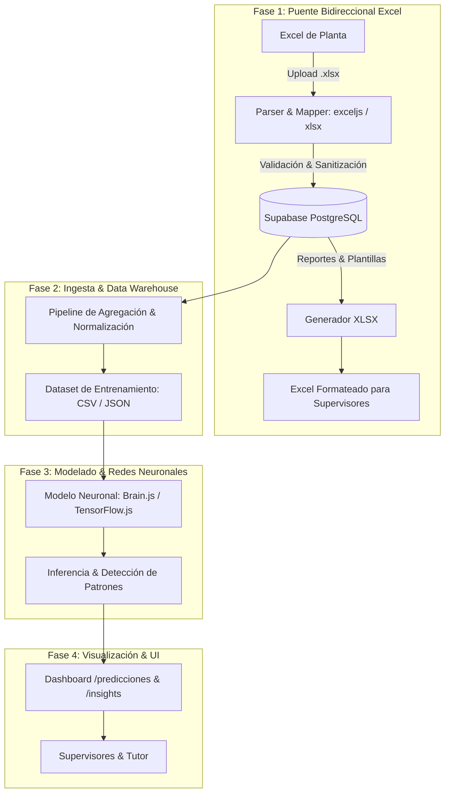

# 🧠 Propuesta Técnica: Integración de Redes Neuronales & Puente Bidireccional de Excel

**Proyecto:** ERP & SaaS Gato Negro  
**Fecha:** Octubre 2026  
**Autor:** Gonzalo Andrés Jaimes & Asistente Antigravity  
**Estado:** Propuesta de Arquitectura y Plan de Implementación  

---

## 1. 🎯 Diagnóstico y Justificación

### A. Realidad Operativa (La barrera del Excel)
El personal de planta y supervisores de fábrica están históricamente habituados a registrar pesajes, recepciones y entregas en libros de **Microsoft Excel** (`FORMATO NUEVO NOMINA FABRIQUIN`, `FORMATO RECEPCION TABACOS`, etc.). Exigirles una migración 100% manual a la plataforma web de la noche a la mañana crea fricción, errores de digitación y resistencia al cambio.

### B. El Potencial de Datos Ocultos (Patrones y Redes Neuronales)
En el proceso de manufactura de tabacos existen relaciones no lineales clave:
- Calidad/humedad del lote de picadura y capa vs. rendimiento en libras.
- Merma esperada por torcedor o envolvedora según turno o día de la semana.
- Curvas de agotamiento de insumos (anillos, papel, ligas) vs. pedidos entrantes.
- Detección temprana de anomalías (mermas sospechosas o registros atípicos).

Una arquitectura de **Redes Neuronales / Machine Learning progresivo** permitirá evolucionar el software desde un sistema de registro reactivo a una plataforma de **toma de decisiones predictiva**.

---

## 2. 🏗️ Arquitectura Modular en 4 Fases

---

## 3. 📋 Detalle de Fases de Ejecución

### 🔄 Fase 1: Módulo Puente de Excel (Bidireccional)
**Objetivo:** Permitir que los supervisores sigan usando o importando sus hojas de cálculo sin perder la sincronización con la base de datos de Supabase.

1. **Importación Inteligente (.xlsx ➔ Plataforma):**
   - Carga de archivos arrastrando (`drag & drop`).
   - Mapeo automático de columnas con validaciones de tipos:
     - Detección de código de operario, kilos/libras entregadas, tabacos recibidos.
   - Vista previa de confirmación con resaltado de inconsistencias antes de escribir en base de datos.
   - Inserción transaccional por lotes (evita duplicados o cargas a medias).

2. **Exportación Fidedigna (Plataforma ➔ .xlsx):**
   - Generación de hojas de cálculo respetando los formatos históricos que la administración ya conoce (fórmulas de nómina, resumen de rezagos y balances de inventario).
   - Descarga instantánea por rango de fechas, semana o módulo operativo.

---

### 🧬 Fase 2: Limpieza de Datos y Extracción de Features (Características)
**Objetivo:** Alimentar la red con datos estructurados y normalizados.

- **Variables de Entrada (Features):**
  - ID de operario / nivel de experiencia.
  - Tipo y peso de materia prima entregada (libras de capa, capote, picadura).
  - Condiciones del lote / proveedor de tabaco.
  - Día de la semana y turno de producción.
  - Histórico de merma promedio del operario en las últimas 4 semanas.
- **Variables Objetivo (Targets de Predicción):**
  - Unidades esperadas producidas (tabacos buenos).
  - Merma estimada (% de descarte).
  - Fecha estimada de quiebre de stock de insumos críticos.

---

### 🧠 Fase 3: Redes Neuronales Progresivas (Evolución por Etapas)

1. **Etapa 3.1: Detección de Patrones y Agrupamiento (Clustering & Heurística):**
   - Clasificación de operarios en perfiles de rendimiento (alto rendimiento, estándar, en riesgo de alta merma).
   - Detección de anomalías en tiempo real (alertar si una recepción se desvía más de 2 desviaciones estándar de lo esperado).
2. **Etapa 3.2: Redes Neuronales Perceptrón Multicapa (MLP) / Regresión No Lineal:**
   - Implementación inicial ligera en Node.js mediante **TensorFlow.js** o **Brain.js** para no requerir servidores pesados adicionales.
   - Entrenamiento periódico (semanal o mensual) conforme ingresan más datos reales de los Excels y del uso diario.
3. **Etapa 3.3: Predicción de Series Temporales (LSTM / Forecasting):**
   - Predicción de consumo semanal de insumos para sugerir órdenes de compra a proveedores antes de quedarse sin stock.

---

### 📊 Fase 4: Módulo Visual "Centro de Inteligencia & Predicciones"
**Objetivo:** Una interfaz atractiva y fácil de interpretar para el tutor, inversionistas y gerencia.

- **Ruta propuesta:** `/insights` o `/predicciones`.
- **Componentes Visuales:**
  - **Tarjetas de Tendencia:** *"Merma estimada para esta semana: 4.2% (-0.8% respecto a la anterior)"*.
  - **Gráfico Comparativo Real vs. Predicho (Chart.js):** Curva de producción real superpuesta con la curva proyectada por la red.
  - **Semáforo de Anomalías:** Alertas automáticas para lotes con comportamientos atípicos.
  - **Simulador Interactivo:** Un panel tipo *"What-if"* donde el supervisor ingresa: *"Si entrego 50 lbs de Capa X a Juan Pérez, ¿cuántos tabacos debería esperar?"*.

---

## 4. 🛠️ Stack Tecnológico Sugerido

| Componente | Tecnología | Justificación |
| :--- | :--- | :--- |
| **Manejo de Excel** | `exceljs` | Soporta lectura, escritura, formato de celdas y fórmulas complejas sin dañar plantillas. |
| **Pipeline de Ingesta** | Node.js + Multer | Manejo eficiente de carga de archivos en memoria o disco temporal. |
| **Motor de Redes Neuronales** | `@tensorflow/tfjs-node` o `brain.js` | Ejecución nativa dentro del mismo runtime de Node.js sin obligar a mantener un servidor Python separado de inicio. |
| **Visualización** | `Chart.js` | Gráficos reactivos, ligeros y fáciles de integrar con el diseño Dark & Orange. |
| **Almacenamiento de Pesos/Modelos** | Supabase Storage / JSON | Persistencia de modelos entrenados para inferencia rápida en milisegundos. |

---

## 5. 🚀 Plan de Trabajo Paso a Paso

1. **Paso 1 (Prioridad Inmediata):** Probar e implementar el **Importador/Exportador de Excel** para la tabla de recepción de tabacos y nómina. Con esto se obtiene la data histórica completa de la fábrica sin fricción.
2. **Paso 2:** Crear la vista `/insights` con el diseño temático Gato Negro para centralizar reportes estadísticos previos.
3. **Paso 3:** Entrenar el primer modelo de red neuronal de predicción de rendimiento y merma con el dataset compilado de los Excels.
4. **Paso 4:** Conectar el simulador y las predicciones a la vista web para presentar los resultados al tutor.
