# Fase 6 · Cinco comparaciones antes / después

Las imágenes «antes» son capturas reales del **commit original `a24fbc5`** (anterior al rediseño parcial y a este taller), ejecutado en un servidor aparte con la misma base de datos. Las «después» son de la rama `feature/taller-mejoramiento`. Todas se tomaron con el mismo navegador y tamaño (escritorio 1366 px y móvil 375 px). Las cifras son mediciones propias (auditoría `herramientas/auditoria_a11y.js`, búsquedas en el código y conteos en el DOM), no estimaciones. Cuando algo **no** quedó resuelto se dice.

## Comparación 1 · Dashboard (`/analitica`)

| Antes (escritorio) | Después (escritorio) |
|---|---|
| 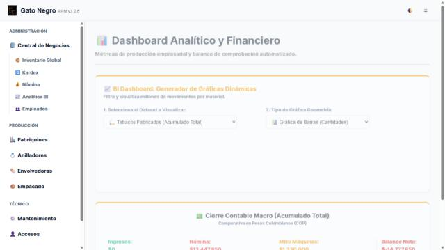 | 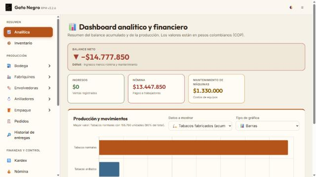 |
| 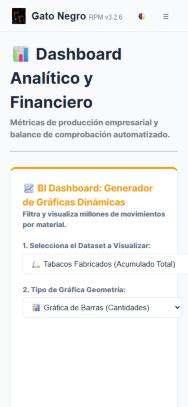 | 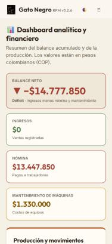 |

| Campo | Registro |
|---|---|
| **Problema original** | (a) La gráfica **no se dibujaba**: `JSON.parse` fallaba porque el JSON iba en un atributo HTML sin escapar (hallazgo 19), y nadie lo avisaba. (b) Los controles de la gráfica estaban antes que la métrica clave y el **Balance neto quedaba bajo el pliegue** (hallazgo 14). (c) Dos `<select>` sin etiqueta y la gráfica sin alternativa textual (16) |
| **Principio aplicado** | Jerarquía visual (lo primero que debe entenderse, arriba); visibilidad del estado y recuperación de errores (Nielsen 1 y 9); alternativa textual (WCAG 1.1.1) y no depender solo del color (1.4.1) |
| **Cambio en código** | `views/admin/analitica.ejs`: fila de KPI con el balance primero (`.kpi`, símbolo ▲/▼ y «Superávit/Déficit»); datos en `<script type="application/json">` en lugar de `data-raw="…"`; resumen textual + tabla alternativa + `aria-label`; colores de la gráfica leídos de `--chart-1…6`; estados vacío y error; `chart.js@4.4.1` con versión fijada. Commits `de97435` (primer arreglo del JSON), `591013e`, `f2ebed7` |
| **Resultado medido** | La gráfica dibuja en los 4 conjuntos de datos y en los 4 tipos; el balance se ve sin desplazarse en los 3 tamaños; controles etiquetados 0 de 2 → **2 de 2**; textos bajo el contraste mínimo 3 → **0** (de 79); la gráfica se redibuja al cambiar de modo oscuro |

## Comparación 2 · Gestión de empleados (`/empleados`)

| Antes (escritorio) | Después (escritorio) |
|---|---|
| 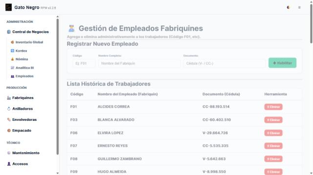 | 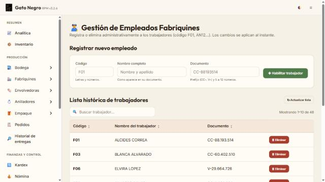 |
| 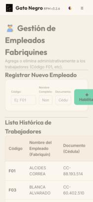 | 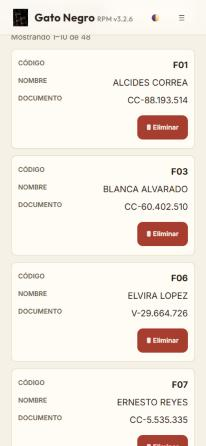 |

| Campo | Registro |
|---|---|
| **Problema original** | Campos con el *placeholder* como única guía y etiquetas de 11 px sin asociar (2, 3); borrar con `confirm()` nativo y botón pequeño (5); 48 trabajadores en una lista sin buscador, orden ni paginación (6); en móvil la tabla se cortaba y la columna de acciones quedaba fuera de pantalla, con inputs apretados («Non», «Cédu») (7) |
| **Principio aplicado** | Prevención de errores y mensajes que dicen cómo corregir (Nielsen 5 y 9); reconocer en vez de recordar (etiquetas y ayudas visibles); diseño adaptable sin pérdida de contenido (WCAG 1.4.10) y objetivos táctiles de 44 px (2.5.5) |
| **Cambio en código** | `views/admin/empleados.ejs` reconstruida con el kit `public/js/ui.js` (`UI.form`, `UI.tabla`, `UI.confirm`); `src/routes/admin.js` valida en el servidor y responde 422 con un mensaje por campo; tabla `class="table-cards"` con `data-col` (esencial / secundaria). Commits `27aaf74`, `591013e` |
| **Resultado medido** | 48 filas → **10 por página** con búsqueda («88193514» encuentra «CC-88.193.514»), orden por columna y `aria-sort`; sin desborde horizontal en 1366, 768 y 375 px; en móvil «Eliminar», «Actualizar», «Habilitar» y los campos miden **44 px** de alto (medido; durante la Fase 4 «Eliminar» medía 32 px hasta que se añadió la regla táctil); controles sin etiqueta 3 de 3 → **0**; textos bajo el contraste 0 de 110; borrar pide confirmación con foco inicial en «Cancelar» y cierre con Escape |

## Comparación 3 · Formulario crítico de Despacho (`/despacho`)

| Antes (escritorio) | Después (escritorio) |
|---|---|
| 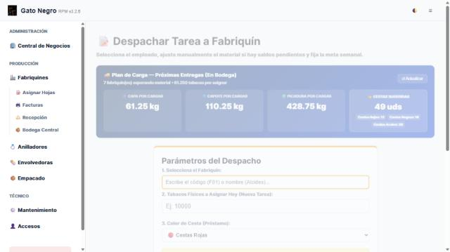 | 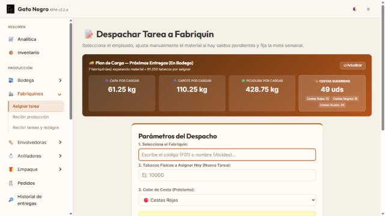 |
| 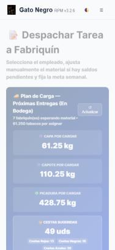 | 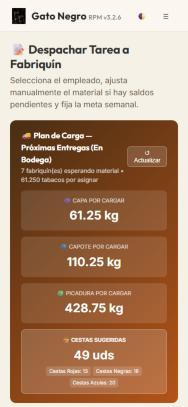 |

| Campo | Registro |
|---|---|
| **Problema original** | 14 controles sin etiqueta asociada (8 visibles) y 7 que solo tenían *placeholder* (2, 3); el selector de fabriquín era una lista de `div` con `onclick`, **inutilizable con teclado**; 3 `alert()` bloqueantes (4); botón sin clase con texto negro sobre cobre (4,22:1); 18 textos bajo el contraste mínimo; salto de encabezado h1 → h3 |
| **Principio aplicado** | Etiquetas y instrucciones (WCAG 3.3.2), operable por teclado (2.1.1), identificar el error y devolver el foco (3.3.1); retroalimentación que no interrumpe |
| **Cambio en código** | `views/produccion/despacho.ejs`: `label for` en cada control; combobox accesible (`role="combobox"`, `listbox`, `option`, `aria-activedescendant`, flechas, Enter y Escape); `alert()` → avisos con foco al campo; botones con `.btn`; colores a tokens; **la lógica de cálculo no se tocó**. Commit `591013e` |
| **Resultado medido** | Controles sin etiqueta 8 de 8 → **0**; solo *placeholder* 7 → **0**; `alert()` 3 → **0**; textos bajo el contraste 18 → **0** (14 sobre fondo degradado quedan sin evaluar); selector operable con ↑ ↓ Enter probado con teclas reales; el cálculo da lo mismo que antes (2 500 tabacos → 2,5 kg de capa, 4,5 de capote, 17,5 de picadura y 2 cestas) |

## Comparación 4 · Kardex: formularios y tabla (`/movimientos`)

| Antes (escritorio) | Después (escritorio) |
|---|---|
| 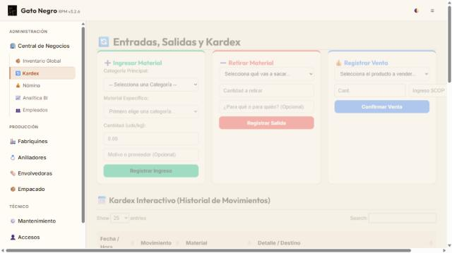 | 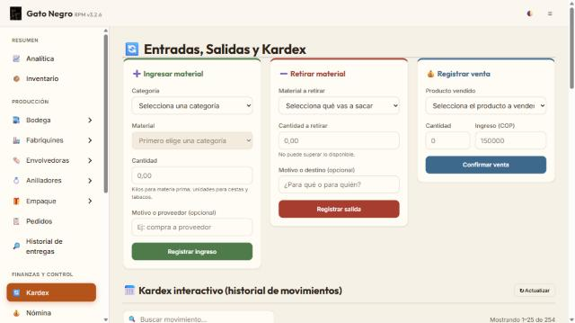 |
|  | 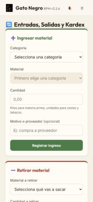 |

| Campo | Registro |
|---|---|
| **Problema original** | 11 de 13 controles sin etiqueta y 186 estilos inline (10); tres formularios que competían arriba (8); tabla con jQuery + DataTables por CDN sin integridad (9) y **textos de la tabla en inglés** («Show 25 entries / Search:») porque el CSP bloqueaba su archivo de idioma; sin filtros ni forma de ver el detalle de un movimiento |
| **Principio aplicado** | Consistencia y estándares (el mismo componente de tabla y de campo en toda la aplicación); flexibilidad y eficiencia (búsqueda, filtro y orden); ayudar a reconocer y corregir errores («Solo hay 1000 disponibles de Anillos; escribe 1000 o menos») |
| **Cambio en código** | `views/admin/movimientos_kardex.ejs`: formularios con `label for`, ayudas y validación por campo; tabla con `UI.tabla` (búsqueda, filtro Entradas/Salidas, orden numérico real, paginación 25/50/100, tarjetas en móvil, detalle bajo demanda); se eliminó jQuery y DataTables. Commits `591013e`, `f7b5416` |
| **Resultado medido** | Controles sin etiqueta 11 de 13 → **0**; textos bajo el contraste 21 → **0** (de 258); filtro: 117 entradas + 137 salidas = 254; desborde horizontal eliminado; `style=` en la vista 32 → 15; interfaz de la tabla en español; los 7 estados del módulo diseñados (ver `06_fase4_mejoras.md`) |

## Comparación 5 · Bodega, la pantalla más débil (`/bodega`)

| Antes (escritorio) | Después (escritorio) |
|---|---|
| 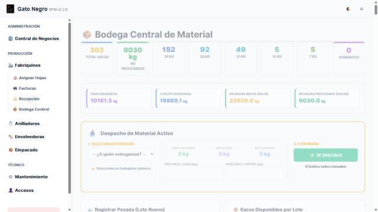 | 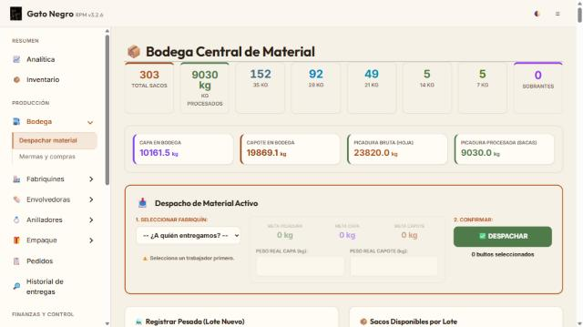 |
| 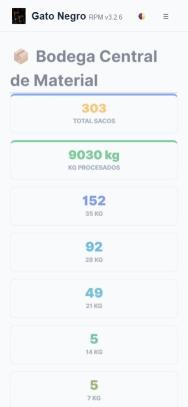 | 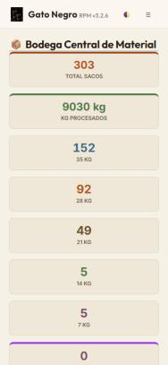 |

| Campo | Registro |
|---|---|
| **Problema original** | 1361 elementos con `style=` en el DOM (1); 13 de 13 controles sin etiqueta; **10 `id` repetidos** porque el bloque «Despacho de material» estaba copiado en un modal que nunca se abría (13); CSS inválido `rgba(var(--text-muted), 0.05)` que el navegador ignoraba; botón con texto negro sobre cobre; 5 textos bajo el contraste mínimo |
| **Principio aplicado** | Estructura robusta y operable (WCAG 4.1.1 y 1.3.1: ids únicos y etiquetas asociadas), contraste mínimo (1.4.3), consistencia con el sistema de diseño |
| **Cambio en código** | `views/produccion/picadura.ejs`: se eliminó el modal duplicado (código muerto), `label for`, `aria-label` en los campos de sacos, un `h2` para ordenar los encabezados, botones `.btn`, colores y fondos a tokens (`--bg-sunken`, `--chart-N`, `--info-soft`). Commit `591013e` |
| **Resultado medido** | `id` duplicados 10 → **0**; controles sin etiqueta 13 de 13 → **0**; saltos de encabezado 1 → **0**; textos bajo el contraste 5 → **1** (es un bloque deshabilitado a propósito, exento en WCAG); ocurrencias de `style=` en el código de la vista 124 → 94 |
| **Lo que NO se resolvió** | Los 8 indicadores de sacos siguen con el mismo peso visual y **en móvil ocupan una fila cada uno** (se ve en la captura «después»): los hallazgos 11 y 12 quedan **abiertos**. También quedan los modales propios de esta pantalla sin `role="dialog"` (hallazgo 13) |

## Resumen de la validación visual

| Comparación | Hallazgos que ataca | Estado |
|---|---|---|
| 1 · Dashboard | 14, 15, 16, 19 | Resueltos |
| 2 · Empleados | 2, 3, 5, 6, 7 | Resueltos |
| 3 · Despacho | 2, 3, 4, 18 | Resueltos en lo medido; 1 hallazgo de estilo inline sin tocar |
| 4 · Kardex | 8 (parcial), 9 (parcial), 10 | Resueltos en lo medido; falta el atributo `integrity` de `chart.js` |
| 5 · Bodega | 1 (parcial), 13 (parcial) | **Parcial**: 11 y 12 abiertos |

## Defecto funcional hallado en las pruebas con usuarios · el despacho no dejaba rastro

Al ejecutar la Tarea 3 (Despacho) con usuarios reales, los datos no aparecían ni en el Kardex ni en el historial de entregas.

| Campo | Registro |
|---|---|
| **Causa** | (1) `POST /despachar_tarea` solo creaba una orden `pendiente` en `despachos_registro`; la salida de capa, capote y picadura no se escribía en `movimientos` en ningún paso del flujo, ni siquiera al confirmar la entrega en Bodega. (2) `/entregas_historicas` lee `recepcion_diaria` (devoluciones), no los despachos. (3) El insert ignoraba el campo `error` que devuelve Supabase, así que un fallo de guardado se mostraba como éxito. |
| **Cambio en código** | `src/routes/produccion.js`: el insert ahora valida el error y, si falla, muestra alerta y no emite la hoja; nueva función `registrarSalidaDespacho` que, al confirmar la entrega (`/entregar_sacos` y `/confirmar_entrega_bodega`), descuenta `inventario` y escribe una fila SALIDA por material en el Kardex; nueva pantalla `/despachos_historicos` (`views/produccion/historial_despachos.ejs`) con búsqueda y estado pendiente/entregado, enlazada en el menú. |
| **Decisión de diseño** | La salida se registra al **entregar** el material (cuando sale físicamente), como definió la versión 2.9.0 al separar factura y entrega; el despacho solo emite la orden. |
| **Verificación** | Prueba del helper con base simulada (3 filas de Kardex y 3 descuentos de inventario) y render de la vista. Falta la prueba de extremo a extremo con sesión de administrador. |

| Campo | Registro (selector de fabriquín en Despacho) |
|---|---|
| **Problema** | Al elegir un fabriquín de la lista con el ratón, la selección no quedaba guardada: el campo se quedaba vacío y `empleado_id` sin valor. Al hacer clic en una opción, el campo de texto perdía el foco y su `onblur` cerraba la lista 200 ms antes de que llegara el clic. |
| **Cambio en código** | `views/produccion/despacho.ejs`: las opciones y el contenedor evitan quitar el foco al campo (`mousedown` con `preventDefault`), y si el texto cambia después de elegir, se invalida la selección previa para no despachar a otra persona. |
| **Verificación** | Con ratón: antes `empleado_id` vacío; después `empleado_id = 3` y texto «F06 - ELVIRA LOPEZ». Prueba completa en la base real con F64: despacho HD-000018, entrega en Bodega con una saca de 7 kg, 3 filas SALIDA en el Kardex (capa 1, capote 1,8, picadura 7), inventario descontado, deuda +1000, despacho «Entregado» en el historial. Todos los datos de prueba se revirtieron. |

| Campo | Registro (registrar el despacho: 404 y «no se guarda») |
|---|---|
| **Problema** | El formulario usaba `target="_blank"` y una redirección a los 2 s. Si el navegador bloquea o no abre la ventana nueva, el POST no llega al servidor: no se guarda el despacho y la pantalla solo se recarga vacía. Además la hoja quedaba en la URL del POST (`/despachar_tarea`), así que recargar o volver atrás daba 404. |
| **Cambio en código** | `despacho.ejs`: el formulario se envía en la misma pestaña, sin `target` ni temporizador. `produccion.js`: tras guardar, redirige (Post/Redirect/Get) a `/reimprimir_factura/<id>?nuevo=1`; `GET /despachar_tarea` redirige a `/despacho`. `hoja_despacho.ejs`: botones «Volver a Despacho» y «Ver historial» (el botón «Cerrar» no funcionaba fuera de una ventana emergente) e impresión automática solo al registrar. |
| **Verificación** | Con el botón real del formulario: antes, sin petición POST ni fila en la base; después, hoja HD-000019 en la misma pestaña, recargar la hoja funciona, aparece en Facturas y en el historial de despachos. La fila de prueba se borró. |
